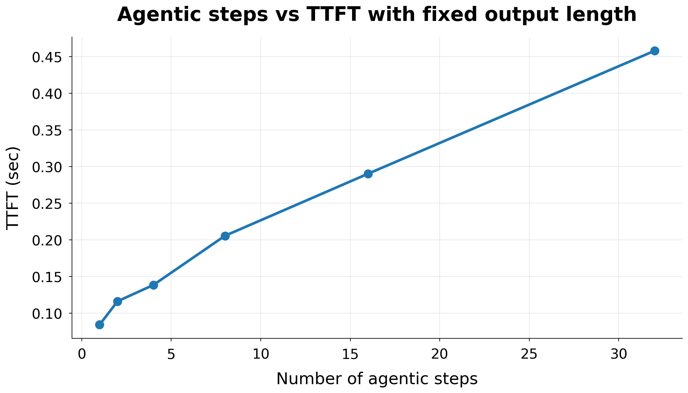
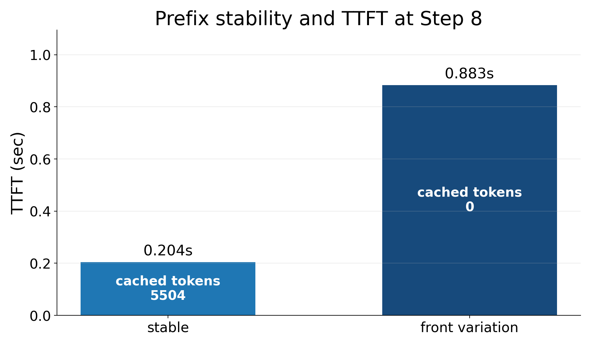
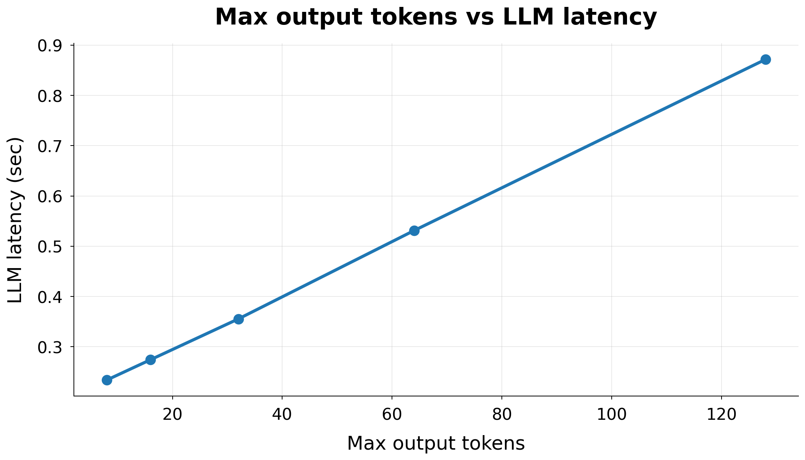
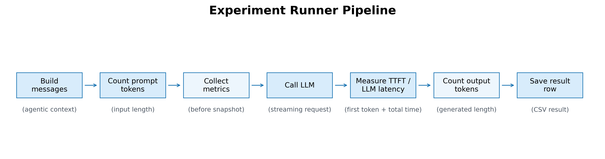

# Agentic LLM Latency Benchmark

[](https://github.com/2Ju1/agentic-llm-latency-benchmark/actions/workflows/ci.yml)

Agentic workload에서 tool result와 대화 이력이 누적될 때 **context length, prefix
cache, TTFT, decode latency가 어떻게 달라지는지** 재현하는 실험 도구입니다. 실험
조건을 명시적인 YAML spec으로 정의하고, OpenAI-compatible endpoint와 Prometheus
metrics를 함께 측정합니다.

## 핵심 결과

테스트 환경은 LLM-D + vLLM, Qwen2.5-1.5B-Instruct, RTX 3090 2장이며 별도 언급이
없으면 temperature 0, concurrency 1입니다.

| 질문 | 통제한 조건 | 관찰 결과 |
|---|---|---|
| Context가 길어지면 TTFT가 증가하는가? | output 32 tokens 고정 | prompt 90→24,717 tokens에서 TTFT 0.084→0.458초 |
| Stable prefix가 cache reuse를 만드는가? | 동일한 8-step workload | stable 0.204초, front variation 0.883초 |
| Output length는 어디에 영향을 주는가? | prompt와 tool output 고정 | TTFT는 유사하고 total LLM latency가 증가 |
| Tool latency와 LLM latency를 분리할 수 있는가? | tool delay만 0→5초로 변경 | LLM latency는 유사하고 E2E에 delay가 합산 |



높은 cache hit rate가 긴 context의 비용을 모두 제거하지는 않았습니다. Prefix cache는
prompt KV 재계산을 줄이지만 첫 output token이 긴 cached KV를 attend하는 비용은 남기
때문입니다. 이 해석은 prefill, decode, external KV transfer metric을 별도로 수집해
검증했습니다.

<p align="center">
  
  
</p>

## 설계 원칙

- 한 번에 하나의 독립 변수만 변경합니다.
- warmup과 measured request를 분리합니다.
- client TTFT와 vLLM의 prefill/decode/cache counter를 함께 기록합니다.
- counter reset은 음수 delta로 보고하지 않습니다.
- raw data와 summary를 함께 보존해 그래프의 근거를 추적할 수 있게 합니다.



## 설치와 사용

Python 3.10 이상이 필요합니다.

```bash
python -m venv .venv
source .venv/bin/activate
pip install -e ".[dev]"
```

실제 요청을 보내지 않고 실험 matrix를 먼저 확인할 수 있습니다.

```bash
agentic-latency plan --config configs/default.yaml
agentic-latency plan --config configs/default.yaml --json
```

LLM-D/vLLM endpoint가 실행 중이라면 matrix를 수행합니다. endpoint와 model은 YAML
또는 `AGENTIC_LATENCY_BASE_URL`, `AGENTIC_LATENCY_MODEL` 환경 변수로 변경할 수
있습니다.

```bash
agentic-latency run \
  --config configs/default.yaml \
  --output outputs/results_raw.csv
```

기존 raw CSV는 다시 요약할 수 있습니다.

```bash
agentic-latency summarize results/results_raw.csv \
  --output outputs/summary.csv
```

## 저장소 구조

```text
configs/                    Versioned experiment specs
src/agentic_latency/        CLI, workload, client, metrics, experiment plan
tests/                      Network/GPU 없이 실행되는 unit tests
results/                    Curated raw evidence and summary
figures/                    Primary result figures
docs/experiment-design.md   Controls, metric boundaries, limitations
```

## 재현 범위와 한계

- 포함된 수치는 위 테스트 환경에서 측정한 결과이며 다른 model/GPU에 일반화하지
  않습니다.
- synthetic workload는 context와 tool output 크기를 통제하기 위한 benchmark이며 실제
  agent trace의 분포를 대표하지 않습니다.
- 실험 실행에는 LLM-D/vLLM endpoint와 해당 Prometheus metrics가 필요하지만 unit test와
  plan 검증은 GPU 없이 실행됩니다.
- raw data의 provenance와 세부 통제 조건은 [experiment design](docs/experiment-design.md)과
  [results index](results/README.md)에 기록했습니다.

## License

MIT

